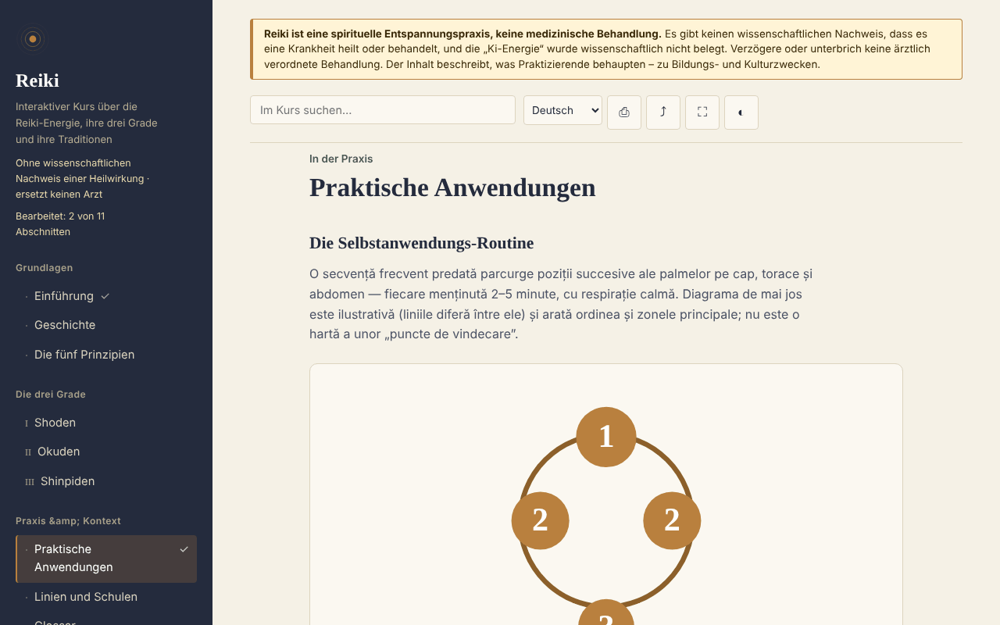

# Reiki — interaktiver Kurs

[English](README.md) · [Română](README.ro.md) · [Français](README.fr.md) · [Italiano](README.it.md) · [Español](README.es.md) · [Português](README.pt.md) · **Deutsch** · [Magyar](README.hu.md)

**Version:** 2.0.0 · **Zuletzt aktualisiert:** 2026-10-26

Oberflächensprachen: **Română, English, Français, Italiano, Español, Português (PT), Deutsch, Magyar**

Ein Lehrkurs über Reiki (Geschichte, Grade, Prinzipien, Glossar, Selbsttest) in einer einzigen HTML-Datei, offline. Eine auf Glauben beruhende Praxis, ohne wissenschaftlichen Nachweis einer Heilwirkung.

**Online:** https://chiuta.github.io/Reiki/

> **Warnhinweis.** Reiki ist eine spirituelle Entspannungspraxis, keine medizinische Behandlung. Es gibt keinen wissenschaftlichen Nachweis, dass es irgendeine Krankheit heilt oder behandelt, und die „Ki-Energie“ ist wissenschaftlich nicht belegt. Verschiebe oder unterbrich keine ärztlich verordnete Behandlung. Der Warnhinweis wird dauerhaft oben auf jeder Seite der App angezeigt.

## Was es ist

Eine Lern-App auf Rumänisch über Reiki, wie Praktizierende es beschreiben: die Geschichte (Usui, Hayashi, Takata), die drei Grade (Shoden, Okuden, Shinpiden), die fünf Prinzipien, Linien und Schulen, ein Glossar japanischer Begriffe. Der Inhalt beschreibt, was Praktizierende behaupten, und stellt keine medizinische Wirksamkeit fest. Historische Punkte, die ich nicht unabhängig überprüfen konnte, sind im Text mit „[neverificat]“ („nicht überprüft“) gekennzeichnet.

## Funktionen

Im Code und im Browser geprüft:
- 11 Abschnitte (Seitenmenü, ☰ auf dem Smartphone): Einführung, Geschichte, Die fünf Prinzipien, Grade I–III, Praktische Anwendungen (mit einem SVG-Diagramm der Positionen), Linien und Schulen, Glossar, Tagebuch, Selbsttest.
- Suche im Kurs, unempfindlich gegenüber diakritischen Zeichen.
- Direktlinks zu Abschnitten (zum Beispiel `#istoric`), und die „Zurück“-Taste des Browsers funktioniert zwischen den Abschnitten.
- Drucken (nur der angezeigte Abschnitt), Teilen (Link, über das Teilen-Menü oder in die Zwischenablage kopiert), Vollbild, Bildschirm aktiv halten (wo der Browser es erlaubt).
- Übungstagebuch: freier Text, automatisch lokal gespeichert (`localStorage`, Schlüssel `reiki.jurnal`), als `.txt` herunterladbar, mit Bestätigung vor dem Leeren.
- Karteikarten für das Glossar (unter „Glossar“, Schaltfläche „Begriffe üben“): Du siehst den Begriff, deckst die Definition auf, markierst „Wusste ich“ oder „Nochmal“ (die Karte kommt nach 2–4 Schritten wieder); bekannte Begriffe werden lokal gemerkt (`reiki.glosarCunoscute`), und am Ende wird dir angezeigt, wie viele du abgehakt hast. Beim Drucken sind sie ausgeblendet.
- Selbsttest mit 10 Fragen und Erläuterungen; die Reihenfolge der Antworten wird bei jedem Versuch gemischt.
- Lokaler Fortschritt: Durchgearbeitete Abschnitte werden im Menü abgehakt (mit Zähler), am Ende jedes Abschnitts stehen Links „Zurück / Weiter“, und das beste Ergebnis im Selbsttest wird gemerkt (`localStorage`, Schlüssel `reiki.parcurse` und `reiki.scorMax`; nichts wird über das Netzwerk gesendet).
- Beachtet `prefers-reduced-motion` (SVG-Animationen stoppen); funktioniert ab 390 px Breite; ohne JavaScript werden alle Abschnitte untereinander angezeigt.

## Anleitung

1. Öffne die Seite und wähle einen Abschnitt im Menü links (auf dem Smartphone drücke ☰).
2. Suche im Suchfeld oben nach einem Begriff; drücke Enter oder wähle ein Ergebnis.
3. Gehe die mit „Exercițiu practic“ („Praktische Übung“) gekennzeichneten Übungen durch (es sind Aufmerksamkeits- und Entspannungsübungen).
4. Schreibe unter „Jurnal“ („Tagebuch“) Notizen, und das Tagebuch wird automatisch in diesem Browser gespeichert; „Descarcă (.txt)“ („Herunterladen (.txt)“) gibt dir eine Kopie, und „Golește“ („Leeren“) löscht es endgültig.
5. Beantworte unter „Autoevaluare“ („Selbsttest“) die Fragen; „Reia testul“ („Test wiederholen“) mischt die Antworten erneut.
6. Die Schaltflächen in der oberen Leiste: Drucken, Teilen, Vollbild, Bildschirm aktiv.

## Datenschutz und Netzwerk

- Lokaler Speicher: das Übungstagebuch in `localStorage` (Schlüssel `reiki.jurnal`), dazu der Fortschritt (`reiki.parcurse`, `reiki.scorMax`, `reiki.glosarCunoscute`), auf deinem Gerät; nichts wird irgendwohin gesendet. Blockiert der Browser den Speicher, bleibt das Tagebuch nur im Arbeitsspeicher und der Browser warnt beim Schließen. `sessionStorage`, IndexedDB und Cookies werden nicht verwendet.
- Netzwerk: Die App stellt keine Netzwerkanfrage (sie hat kein `fetch`, keine externen Skripte, Schriften, Bilder oder iframes) und enthält keine externen Links. Eine CSP-Richtlinie (`default-src 'none'`) in der Seite blockiert jedes externe Laden. Im `<head>` stehen nur Adressen in den Open-Graph-Metadaten (`chiuta.github.io`), auf die die App nicht zugreift.
- Berechtigungen: Sie verlangt keine Berechtigungen. „Bildschirm aktiv“ nutzt die Screen Wake Lock API, und „Teilen“ nutzt das Teilen-Menü des Systems oder die Zwischenablage, beides nur beim Drücken der Schaltfläche.
- Keine Telemetrie, keine Konten.

## Grenzen und Warnhinweise

- Es ist kein medizinisches Material; es ersetzt weder Diagnose noch Behandlung oder ärztliche Überwachung. Bei Symptomen geh zum Arzt.
- Reiki hat über Entspannung und Placebo-Effekt hinaus keinen wissenschaftlichen Wirksamkeitsnachweis; systematische Übersichtsarbeiten (darunter eine Cochrane-Arbeit zu Depression und Angst) fanden keine ausreichenden Belege. Die genaue Quelle ist in der App nicht angegeben, überprüfe sie also, bevor du sie weiter zitierst.
- Die Geschichte folgt den üblichen Quellen; manche im Westen überlieferten Berichte (besonders die von Takata) gelten bei Forschenden als ungenau. Die fünf Prinzipien werden in der westlichen Fassung dargestellt, und die App vermerkt, dass die japanische Fassung abweicht.
- Das Positionsdiagramm ist illustrativ, keine medizinische Karte.
- Die Fernanwendung wird als Annahme der Praktizierenden beschrieben, ohne Wirkungsnachweis.

## Lokal / offline ausführen

Lade `index.html` herunter und öffne sie in einem Browser; sie braucht kein Internet. Für GitHub Pages veröffentliche das Repository (die Datei `.nojekyll` ist enthalten).

## Lizenz

MIT — siehe die Datei LICENSE.

## Autor

Alexio — Alexandru-Ionuț Chiuță, Kontakt: alexio@trom.tf

## Zusammenfassung
Reiki ist ein rumänischsprachiger Offline-Kurs in einer einzigen Datei über Reiki, wie Praktizierende es beschreiben: Geschichte, drei Grade, fünf Prinzipien, Linien, Glossar, Übungstagebuch und ein Quiz mit 10 Fragen. Ein dauerhafter Hinweis stellt klar, dass Reiki eine spirituelle Entspannungspraxis und keine Medizin ist und keinen wissenschaftlichen Nachweis einer Heilwirkung hat. Die App stellt keine Netzwerkanfragen, nutzt keinen Browserspeicher und verlangt keine Berechtigungen; das Tagebuch lässt sich als Textdatei herunterladen. Einige historische Punkte sind ausdrücklich als nicht überprüft gekennzeichnet.

## Verlauf / Changelog

### 1.2.7 — 2026-10-23

- Touch-Ziele von mindestens 44 px auf Touch-Geräten (`pointer:coarse`); der Desktop bleibt unverändert.

### 1.2.5 — 2026-10-22

fff-kit 1.1.4: Touch-Ziele und Mindestschriftgröße.

### 1.2.4 — 2026-10-22
- fff-kit 1.1.2: PBKDF2 mit 600.000 Iterationen, Schutz vor Clickjacking

### 1.2.3 — 2026-10-22
- Die confirm()/prompt()-Fenster des Browsers durch eigene, in die 8 Sprachen übersetzte Dialoge ersetzt (Tagebuch leeren, manuelles Kopieren des Links).

### 1.1.0 — 2026-10-14
- Datensicherung und Datenkennzeichnung (fff-kit).

### 12. Oktober 2026 (v1.0.0)
- 1.0.0 — 2026-10-12: Die Version und das Datum der letzten Aktualisierung werden in der App angezeigt

### 11. Oktober 2026
- Karteikarten für das Glossar („Begriffe üben“, lokaler Fortschritt in `reiki.glosarCunoscute`); getestet: vollständiger Durchlauf, Persistenz nach dem Neuladen, axe 0 in beiden Größen.
- Lokaler Lernfortschritt (durchgearbeitete Abschnitte + Zähler), Navigation Zurück/Weiter zwischen den Abschnitten, bestes Testergebnis; CSP mit `script-src` per SHA-256-Hash, ohne `'unsafe-inline'` für Skripte.
- Das Übungstagebuch wird jetzt lokal gespeichert (`localStorage`) und bleibt nach dem Neuladen erhalten; „Golește“ („Leeren“) löscht es.
- Die Suchergebnisse sind eine Liste (`ul`) mit der Anzahl der gefundenen Abschnitte.
- Ein barrierefreies `h1` im Inhalt ergänzt (axe `page-has-heading-one` auf dem Smartphone); axe 0 Verstöße bei 1280 und 360 px.

Quellen geprüft am 11.10.2026: Es wurden keine neuen externen Fakten zitiert; nicht überprüfte historische Punkte bleiben mit „[neverificat]“ gekennzeichnet
