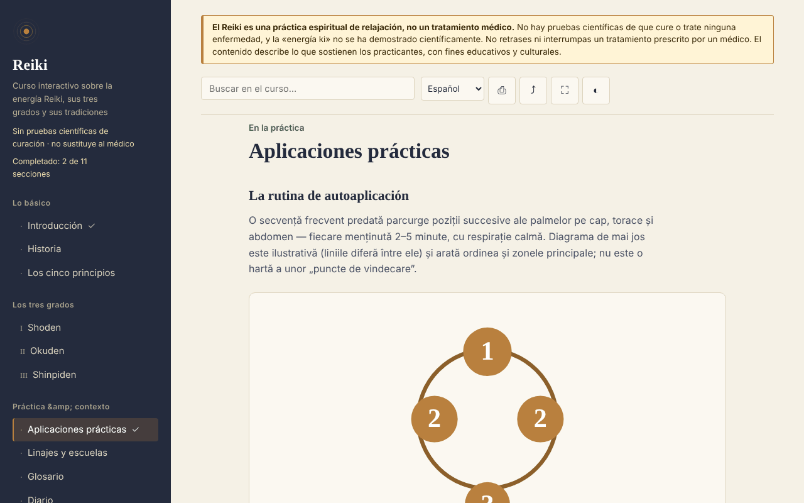

# Reiki — curso interactivo

[English](README.md) · [Română](README.ro.md) · [Français](README.fr.md) · [Italiano](README.it.md) · **Español** · [Português](README.pt.md) · [Deutsch](README.de.md) · [Magyar](README.hu.md)

**Versión:** 1.2.4 · **Última actualización:** 2026-10-22

Idiomas de la interfaz: **Română, English, Français, Italiano, Español, Português (PT), Deutsch, Magyar**

Curso educativo sobre el Reiki (historia, grados, principios, glosario, autoevaluación), en un único archivo HTML, sin conexión. Práctica basada en creencias, sin pruebas científicas de curación.

**En línea:** https://chiuta.github.io/Reiki/

> **Advertencia.** El Reiki es una práctica espiritual de relajación, no un tratamiento médico. No existen pruebas científicas de que cure o trate enfermedad alguna, y la «energía ki» no ha sido demostrada científicamente. No retrases ni interrumpas un tratamiento prescrito por un médico. La advertencia se muestra de forma permanente en la parte superior de cada página de la aplicación.

## Qué es

Una aplicación de aprendizaje en rumano sobre el Reiki tal como lo describen los practicantes: la historia (Usui, Hayashi, Takata), los tres grados (Shoden, Okuden, Shinpiden), los cinco principios, linajes y escuelas, un glosario de términos japoneses. El contenido describe lo que sostienen los practicantes, sin afirmar eficacia médica. Los puntos históricos que no he podido verificar de forma independiente están marcados en el texto como «[neverificat]» («no verificado»).

## Funciones

Verificadas en el código y en el navegador:
- 11 secciones (menú lateral, ☰ en móvil): Introducción, Historia, Los cinco principios, Grados I–III, Aplicaciones prácticas (con un diagrama SVG de las posiciones), Linajes y escuelas, Glosario, Diario, Autoevaluación.
- Búsqueda en el curso, insensible a los signos diacríticos.
- Enlaces directos a las secciones (por ejemplo `#istoric`), y el botón «atrás» del navegador funciona entre secciones.
- Impresión (solo la sección mostrada), compartir (enlace, mediante el menú de compartir o copiado al portapapeles), pantalla completa, mantener la pantalla activa (donde el navegador lo permita).
- Diario de práctica: texto libre, guardado automáticamente en local (`localStorage`, clave `reiki.jurnal`), descargable como `.txt`, con confirmación antes de vaciarlo.
- Tarjetas del glosario (en «Glosario», botón «Practica los términos»): ves el término, muestras la definición, marcas «Lo sabía» o «Repetir más» (la tarjeta vuelve tras 2–4 pasos); los términos conocidos se recuerdan en local (`reiki.glosarCunoscute`), y al final se te indica cuántos has marcado. Se ocultan al imprimir.
- Autoevaluación de 10 preguntas con explicaciones; el orden de las respuestas se mezcla en cada intento.
- Progreso local: las secciones recorridas se marcan en el menú (con un contador), al final de cada sección hay enlaces «Anterior / Siguiente», y se recuerda la mejor puntuación de la autoevaluación (`localStorage`, claves `reiki.parcurse` y `reiki.scorMax`; no se envía nada por la red).
- Respeta `prefers-reduced-motion` (las animaciones SVG se detienen); funciona desde 390 px de ancho; sin JavaScript se muestran todas las secciones una debajo de otra.

## Manual de uso

1. Abre la página y elige una sección en el menú de la izquierda (en móvil, pulsa ☰).
2. Busca un término en el campo de búsqueda de la parte superior; pulsa Intro o elige un resultado.
3. Realiza los ejercicios marcados «Exercițiu practic» («Ejercicio práctico») (son ejercicios de atención y relajación).
4. En «Jurnal» («Diario») escribe notas y el diario se guarda automáticamente en este navegador; «Descarcă (.txt)» («Descargar (.txt)») te da una copia, y «Golește» («Vaciar») lo borra definitivamente.
5. En «Autoevaluare» («Autoevaluación») responde a las preguntas; «Reia testul» («Repetir el test») vuelve a mezclar las respuestas.
6. Los botones de la barra superior: imprimir, compartir, pantalla completa, pantalla activa.

## Privacidad y red

- Almacenamiento local: el diario de práctica, en `localStorage` (clave `reiki.jurnal`), más el progreso (`reiki.parcurse`, `reiki.scorMax`, `reiki.glosarCunoscute`), en tu dispositivo; no se envía a ninguna parte. Si el navegador bloquea el almacenamiento, el diario queda solo en memoria y el navegador avisa al cerrar. No se usan `sessionStorage`, IndexedDB ni cookies.
- Red: la aplicación no hace ninguna solicitud de red (no tiene `fetch`, scripts, fuentes, imágenes ni iframes externos) y no contiene enlaces externos. Una política CSP (`default-src 'none'`) en la página bloquea cualquier carga externa. En `<head>` solo aparecen direcciones en los metadatos Open Graph (`chiuta.github.io`), a las que la aplicación no accede.
- Permisos: no solicita permisos. «Pantalla activa» usa la Screen Wake Lock API, y «Compartir» usa el menú de compartir del sistema o el portapapeles, ambos solo al pulsar el botón.
- Cero telemetría, sin cuentas.

## Límites y advertencias

- No es material médico; no sustituye el diagnóstico, el tratamiento ni el seguimiento médico. Ante síntomas, acude al médico.
- El Reiki no tiene pruebas científicas de eficacia más allá de la relajación y el efecto placebo; las revisiones sistemáticas (incluida una de Cochrane sobre depresión y ansiedad) no encontraron pruebas suficientes. La referencia exacta no se cita en la aplicación, así que compruébala antes de citarla en otro sitio.
- La historia sigue las fuentes habituales; algunos relatos transmitidos en Occidente (en especial los de Takata) son considerados inexactos por los investigadores. Los cinco principios se presentan en la versión occidental, y la aplicación señala que la versión japonesa difiere.
- El diagrama de posiciones es ilustrativo, no un mapa médico.
- La práctica a distancia se describe como una premisa de los practicantes, sin pruebas de efecto.

## Ejecución local / sin conexión

Descarga `index.html` y ábrelo en un navegador; no necesita Internet. Para GitHub Pages, publica el repositorio (el archivo `.nojekyll` está incluido).

## Licencia

MIT — véase el archivo LICENSE.

## Autor

Alexio — Alexandru-Ionuț Chiuță, contacto: alexio@trom.tf

## Resumen

Reiki es un curso en rumano, en un solo archivo y sin conexión, sobre el Reiki tal como lo describen los practicantes: historia, tres grados, cinco principios, linajes, glosario, diario de práctica y un cuestionario de 10 preguntas. Un aviso permanente indica que el Reiki es una práctica espiritual de relajación, no medicina, y que no tiene pruebas científicas de curación. La aplicación no hace solicitudes de red, no usa el almacenamiento del navegador y no solicita permisos; el diario puede descargarse como archivo de texto. Algunos puntos históricos se marcan explícitamente como no verificados.

## Historial / Changelog

### 1.2.4 — 2026-10-22
- fff-kit 1.1.2: PBKDF2 con 600.000 iteraciones, protección anti-clickjacking

### 1.2.3 — 2026-10-22
- Los cuadros confirm()/prompt() del navegador sustituidos por diálogos propios traducidos a los 8 idiomas (vaciar el diario, copia manual del enlace).

### 1.1.0 — 2026-10-14
- Copia de seguridad y etiquetado de datos (fff-kit).

### 12 de octubre de 2026 (v1.0.0)
- 1.0.0 — 2026-10-12: la versión y la fecha de la última actualización se muestran en la aplicación

### 11 de octubre de 2026
- Tarjetas del glosario («Practica los términos», progreso local en `reiki.glosarCunoscute`); probado: recorrido completo, persistencia tras recargar, axe 0 en ambos tamaños.
- Progreso de aprendizaje local (secciones recorridas + contador), navegación Anterior/Siguiente entre secciones, mejor puntuación en el test; CSP con `script-src` por hash SHA-256, sin `'unsafe-inline'` para scripts.
- El diario de práctica se guarda ahora en local (`localStorage`) y permanece tras recargar; «Golește» («Vaciar») lo borra.
- Los resultados de búsqueda son una lista (`ul`) con el número de secciones encontradas.
- Añadido un `h1` accesible en el contenido (axe `page-has-heading-one` en móvil); axe 0 infracciones a 1280 y 360 px.

Fuentes verificadas el 11.10.2026: no se citaron hechos externos nuevos; los puntos históricos no verificados siguen marcados como «[neverificat]»
