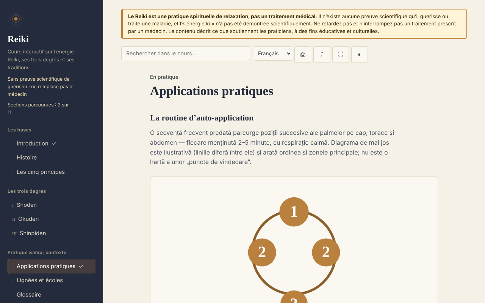

# Reiki — cours interactif

[English](README.md) · [Română](README.ro.md) · **Français** · [Italiano](README.it.md) · [Español](README.es.md) · [Português](README.pt.md) · [Deutsch](README.de.md) · [Magyar](README.hu.md)

**Version :** 2.0.0 · **Dernière mise à jour :** 2026-10-26

Langues de l'interface : **Română, English, Français, Italiano, Español, Português (PT), Deutsch, Magyar**

Cours éducatif sur le Reiki (histoire, degrés, principes, glossaire, autoévaluation), dans un seul fichier HTML, hors ligne. Pratique fondée sur des croyances, sans preuve scientifique de guérison.

**En ligne :** https://chiuta.github.io/Reiki/

> **Avertissement.** Le Reiki est une pratique spirituelle de relaxation, et non un traitement médical. Il n'existe aucune preuve scientifique qu'il guérisse ou traite une maladie, et l'« énergie ki » n'a pas été démontrée scientifiquement. Ne retardez pas et n'interrompez pas un traitement prescrit par un médecin. L'avertissement est affiché en permanence en haut de chaque page de l'application.

## Ce que c'est

Une application d'apprentissage en roumain sur le Reiki tel que le décrivent les praticiens : l'histoire (Usui, Hayashi, Takata), les trois degrés (Shoden, Okuden, Shinpiden), les cinq principes, les lignées et les écoles, un glossaire de termes japonais. Le contenu décrit ce que soutiennent les praticiens, sans affirmer d'efficacité médicale. Les points historiques que je n'ai pas pu vérifier de façon indépendante sont marqués « [neverificat] » (« non vérifié ») dans le texte.

## Fonctions

Vérifiées dans le code et dans le navigateur :
- 11 sections (menu latéral, ☰ sur mobile) : Introduction, Histoire, Les cinq principes, Degrés I–III, Applications pratiques (avec un schéma SVG des positions), Lignées et écoles, Glossaire, Journal, Autoévaluation.
- Recherche dans le cours, insensible aux diacritiques.
- Liens directs vers les sections (par exemple `#istoric`), et le bouton « retour » du navigateur fonctionne entre les sections.
- Impression (uniquement la section affichée), partage (lien, via le menu de partage ou copié dans le presse-papiers), plein écran, maintien de l'écran allumé (là où le navigateur le permet).
- Journal de pratique : texte libre, enregistré automatiquement en local (`localStorage`, clé `reiki.jurnal`), téléchargeable en `.txt`, avec confirmation avant effacement.
- Cartes de révision du glossaire (dans « Glossaire », bouton « S'exercer sur les termes ») : vous voyez le terme, vous révélez la définition, vous marquez « Je savais » ou « À revoir » (la carte revient après 2 à 4 étapes) ; les termes connus sont retenus localement (`reiki.glosarCunoscute`), et à la fin on vous indique combien vous en avez cochés. Elles sont masquées à l'impression.
- Autoévaluation de 10 questions avec explications ; l'ordre des réponses est mélangé à chaque essai.
- Progression locale : les sections parcourues sont cochées dans le menu (avec un compteur), à la fin de chaque section figurent des liens « Précédent / Suivant », et le meilleur score de l'autoévaluation est retenu (`localStorage`, clés `reiki.parcurse` et `reiki.scorMax` ; rien n'est envoyé sur le réseau).
- Respecte `prefers-reduced-motion` (les animations SVG s'arrêtent) ; fonctionne dès 390 px de largeur ; sans JavaScript, toutes les sections s'affichent les unes sous les autres.

## Mode d'emploi

1. Ouvrez la page et choisissez une section dans le menu de gauche (sur mobile, appuyez sur ☰).
2. Cherchez un terme dans le champ de recherche en haut ; appuyez sur Entrée ou choisissez un résultat.
3. Parcourez les exercices marqués « Exercițiu practic » (« Exercice pratique ») (ce sont des exercices d'attention et de relaxation).
4. Dans « Jurnal » (« Journal »), écrivez des notes ; le journal est enregistré automatiquement dans ce navigateur ; « Descarcă (.txt) » (« Télécharger (.txt) ») vous en donne une copie, et « Golește » (« Vider ») le supprime définitivement.
5. Dans « Autoevaluare » (« Autoévaluation »), répondez aux questions ; « Reia testul » (« Refaire le test ») mélange de nouveau les réponses.
6. Les boutons de la barre supérieure : impression, partage, plein écran, écran allumé.

## Confidentialité et réseau

- Stockage local : le journal de pratique, dans `localStorage` (clé `reiki.jurnal`), plus la progression (`reiki.parcurse`, `reiki.scorMax`, `reiki.glosarCunoscute`), sur votre appareil ; rien n'est envoyé nulle part. Si le navigateur bloque le stockage, le journal reste uniquement en mémoire et le navigateur avertit à la fermeture. `sessionStorage`, IndexedDB et les cookies ne sont pas utilisés.
- Réseau : l'application n'effectue aucune requête réseau (elle n'a ni `fetch`, ni scripts, polices, images ou iframes externes) et ne contient aucun lien externe. Une politique CSP (`default-src 'none'`) dans la page bloque tout chargement externe. Dans `<head>`, il n'y a que des adresses dans les métadonnées Open Graph (`chiuta.github.io`), auxquelles l'application n'accède pas.
- Autorisations : elle ne demande aucune autorisation. « Écran allumé » utilise la Screen Wake Lock API, et « Partager » utilise le menu de partage du système ou le presse-papiers, tous deux uniquement lorsque vous appuyez sur le bouton.
- Zéro télémétrie, pas de comptes.

## Limites et avertissements

- Ce n'est pas un document médical ; il ne remplace ni le diagnostic, ni le traitement, ni le suivi médical. En cas de symptômes, consultez un médecin.
- Le Reiki n'a pas de preuve scientifique d'efficacité au-delà de la relaxation et de l'effet placebo ; les revues systématiques (dont une de la Cochrane sur la dépression et l'anxiété) n'ont pas trouvé de preuves suffisantes. La référence exacte n'est pas citée dans l'application, vérifiez-la donc avant de la citer ailleurs.
- L'histoire suit les sources habituelles ; certains récits transmis en Occident (notamment ceux de Takata) sont jugés inexacts par les chercheurs. Les cinq principes sont présentés dans la version occidentale, et l'application note que la version japonaise diffère.
- Le schéma des positions est illustratif, ce n'est pas une carte médicale.
- La pratique à distance est décrite comme une prémisse des praticiens, sans preuve d'effet.

## Exécution locale / hors ligne

Téléchargez `index.html` et ouvrez-le dans un navigateur ; il n'a pas besoin d'Internet. Pour GitHub Pages, publiez le dépôt (le fichier `.nojekyll` est inclus).

## Licence

MIT — voir le fichier LICENSE.

## Auteur

Alexio — Alexandru-Ionuț Chiuță, contact : alexio@trom.tf

## Résumé
Reiki est un cours en roumain, en un seul fichier et hors ligne, sur le Reiki tel que le décrivent les praticiens : histoire, trois degrés, cinq principes, lignées, glossaire, journal de pratique et quiz de 10 questions. Un avis permanent indique que le Reiki est une pratique spirituelle de relaxation, non une médecine, et qu'il n'a aucune preuve scientifique de guérison. L'application n'effectue aucune requête réseau, n'utilise aucun stockage du navigateur et ne demande aucune autorisation ; le journal peut être téléchargé sous forme de fichier texte. Certains points historiques sont explicitement signalés comme non vérifiés.

## Historique / Changelog

### 1.2.7 — 2026-10-23

- Cibles tactiles d’au moins 44 px sur les appareils tactiles (`pointer:coarse`) ; le bureau reste inchangé.

### 1.2.5 — 2026-10-22

fff-kit 1.1.4 : cibles tactiles et taille de texte minimale.

### 1.2.4 — 2026-10-22
- fff-kit 1.1.2 : PBKDF2 à 600 000 itérations, protection anti-clickjacking

### 1.2.3 — 2026-10-22
- Les boîtes confirm()/prompt() du navigateur remplacées par des dialogues propres, traduits dans les 8 langues (vidage du journal, copie manuelle du lien).

### 1.1.0 — 2026-10-14
- Sauvegarde et étiquetage des données (fff-kit).

### 12 octobre 2026 (v1.0.0)
- 1.0.0 — 2026-10-12 : la version et la date de la dernière mise à jour sont affichées dans l'application

### 11 octobre 2026
- Cartes de révision du glossaire (« S'exercer sur les termes », progression locale dans `reiki.glosarCunoscute`) ; testé : parcours complet, persistance après rechargement, axe 0 aux deux tailles.
- Progression d'apprentissage locale (sections parcourues + compteur), navigation Précédent/Suivant entre les sections, meilleur score au test ; CSP avec `script-src` par hachage SHA-256, sans `'unsafe-inline'` pour les scripts.
- Le journal de pratique est désormais enregistré localement (`localStorage`) et subsiste après rechargement ; « Golește » (« Vider ») le supprime.
- Les résultats de recherche sont une liste (`ul`) avec le nombre de sections trouvées.
- Ajout d'un `h1` accessible dans le contenu (axe `page-has-heading-one` sur mobile) ; axe 0 violation à 1280 et 360 px.

Sources vérifiées le 11.10.2026 : aucun nouveau fait externe n'a été cité ; les points historiques non vérifiés restent marqués « [neverificat] »
