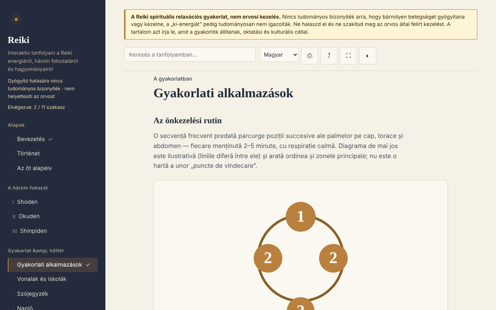

# Reiki — interaktív tanfolyam

[English](README.md) · [Română](README.ro.md) · [Français](README.fr.md) · [Italiano](README.it.md) · [Español](README.es.md) · [Português](README.pt.md) · [Deutsch](README.de.md) · **Magyar**

**Verzió:** 1.2.5 · **Utolsó frissítés:** 2026-10-22

A felület nyelvei: **Română, English, Français, Italiano, Español, Português (PT), Deutsch, Magyar**

Oktatási tanfolyam a Reikiről (történet, fokozatok, alapelvek, szószedet, önértékelés), egyetlen, offline HTML-fájlban. Hiedelmeken alapuló gyakorlat, a gyógyításra vonatkozó tudományos bizonyíték nélkül.

**Élő:** https://chiuta.github.io/Reiki/

> **Figyelmeztetés.** A Reiki spirituális relaxációs gyakorlat, nem orvosi kezelés. Nincs tudományos bizonyíték arra, hogy bármilyen betegséget gyógyítana vagy kezelne, és a „ki-energiát” tudományosan nem igazolták. Ne halaszd el és ne szakítsd meg az orvos által felírt kezelést. A figyelmeztetés az alkalmazás minden oldalának tetején folyamatosan látható.

## Mi ez

Román nyelvű tanulóalkalmazás a Reikiről úgy, ahogyan a gyakorlók leírják: a története (Usui, Hayashi, Takata), a három fokozat (Shoden, Okuden, Shinpiden), az öt alapelv, vonalak és iskolák, japán szakkifejezések szószedete. A tartalom azt írja le, amit a gyakorlók állítanak, orvosi hatékonyságot nem állít. Azok a történeti pontok, amelyeket nem tudtam önállóan ellenőrizni, a szövegben „[neverificat]” („nem ellenőrzött”) jelöléssel szerepelnek.

## Funkciók

A kódban és a böngészőben ellenőrizve:
- 11 szakasz (oldalmenü, mobilon ☰): Bevezetés, Történet, Az öt alapelv, I–III. fokozat, Gyakorlati alkalmazások (a pozíciók SVG-ábrájával), Vonalak és iskolák, Szószedet, Napló, Önértékelés.
- Keresés a tanfolyamban, ékezetekre érzéketlenül.
- Közvetlen hivatkozások a szakaszokra (például `#istoric`), és a böngésző „vissza” gombja működik a szakaszok között.
- Nyomtatás (csak a megjelenített szakasz), megosztás (hivatkozás, a megosztás menün keresztül vagy a vágólapra másolva), teljes képernyő, a képernyő ébren tartása (ahol a böngésző engedi).
- Gyakorlási napló: szabad szöveg, automatikusan helyben mentve (`localStorage`, a `reiki.jurnal` kulcs), `.txt`-ként letölthető, ürítés előtt megerősítéssel.
- Szószedet-kártyák (a „Szószedet”-ben, a „Gyakorold a fogalmakat” gomb): látod a fogalmat, felfeded a meghatározást, megjelölöd, hogy „Tudtam” vagy „Még ismétlem” (a kártya 2–4 lépés után visszatér); az ismert fogalmakat helyben megjegyzi (`reiki.glosarCunoscute`), a végén pedig megtudod, hányat jelöltél be. Nyomtatáskor el vannak rejtve.
- 10 kérdéses önértékelés magyarázatokkal; a válaszok sorrendje minden próbálkozásnál összekeveredik.
- Helyi haladás: a végigvett szakaszok be vannak jelölve a menüben (számlálóval), minden szakasz végén „Előző / Következő” hivatkozások vannak, és az önértékelés legjobb pontszámát megjegyzi (`localStorage`, a `reiki.parcurse` és `reiki.scorMax` kulcsok; semmi sem megy ki a hálózaton).
- Tiszteletben tartja a `prefers-reduced-motion` beállítást (az SVG-animációk leállnak); 390 px szélességtől működik; JavaScript nélkül az összes szakasz egymás alatt jelenik meg.

## Használati útmutató

1. Nyisd meg az oldalt, és válassz egy szakaszt a bal oldali menüből (mobilon nyomd meg a ☰ gombot).
2. Keress egy fogalmat a felső keresőmezőben; nyomj Entert, vagy válassz egy találatot.
3. Végezd el az „Exercițiu practic” („Gyakorlati feladat”) jelölésű gyakorlatokat (figyelem- és relaxációs gyakorlatok).
4. A „Jurnal” („Napló”) részben írj jegyzeteket, a napló automatikusan mentődik ebben a böngészőben; a „Descarcă (.txt)” („Letöltés (.txt)”) másolatot ad, a „Golește” („Ürítés”) véglegesen törli.
5. Az „Autoevaluare” („Önértékelés”) részben válaszolj a kérdésekre; a „Reia testul” („Teszt újra”) ismét összekeveri a válaszokat.
6. A felső sáv gombjai: nyomtatás, megosztás, teljes képernyő, ébren tartás.

## Adatvédelem és hálózat

- Helyi tárhely: a gyakorlási napló a `localStorage`-ban (a `reiki.jurnal` kulcs), valamint a haladás (`reiki.parcurse`, `reiki.scorMax`, `reiki.glosarCunoscute`) az eszközödön; sehová sem kerül elküldésre. Ha a böngésző blokkolja a tárolást, a napló csak a memóriában marad, és a böngésző bezáráskor figyelmeztet. `sessionStorage`-ot, IndexedDB-t és sütiket nem használ.
- Hálózat: az alkalmazás semmilyen hálózati kérést nem küld (nincs `fetch`, külső szkript, betűtípus, kép vagy iframe), és nem tartalmaz külső hivatkozásokat. Az oldalban lévő CSP-szabályzat (`default-src 'none'`) minden külső betöltést blokkol. A `<head>`-ben csak az Open Graph metaadatokban vannak címek (`chiuta.github.io`), amelyeket az alkalmazás nem ér el.
- Engedélyek: nem kér engedélyeket. Az „Ébren tartás” a Screen Wake Lock API-t használja, a „Megosztás” pedig a rendszer megosztás menüjét vagy a vágólapot, mindkettőt csak a gomb megnyomásakor.
- Nulla telemetria, nincsenek fiókok.

## Korlátok és figyelmeztetések

- Nem orvosi anyag; nem helyettesíti az orvosi diagnózist, kezelést vagy felügyeletet. Tünetek esetén fordulj orvoshoz.
- A Reikinek a relaxáción és a placebohatáson túl nincs tudományos bizonyítéka hatékonyságra; a szisztematikus áttekintések (köztük egy Cochrane-áttekintés a depresszióról és a szorongásról) nem találtak elegendő bizonyítékot. A pontos hivatkozás nincs megadva az alkalmazásban, ezért ellenőrizd, mielőtt tovább idéznéd.
- A történet a szokásos forrásokat követi; a Nyugaton terjedt egyes beszámolókat (különösen Takatáét) a kutatók pontatlannak tartják. Az öt alapelv a nyugati változatban szerepel, és az alkalmazás jelzi, hogy a japán változat eltér.
- A pozíciók ábrája szemléltető jellegű, nem orvosi térkép.
- A távgyakorlat a gyakorlók előfeltevéseként van leírva, hatásra vonatkozó bizonyíték nélkül.

## Helyi / offline futtatás

Töltsd le az `index.html` fájlt, és nyisd meg böngészőben; nincs szüksége internetre. A GitHub Pageshez tedd közzé a tárolót (a `.nojekyll` fájl benne van).

## Licenc

MIT — lásd a LICENSE fájlt.

## Szerző

Alexio — Alexandru-Ionuț Chiuță, kapcsolat: alexio@trom.tf

## Összefoglaló
A Reiki egyetlen fájlba zárt, offline, román nyelvű tanfolyam a Reikiről úgy, ahogyan a gyakorlók leírják: történet, három fokozat, öt alapelv, vonalak, szószedet, gyakorlási napló és egy 10 kérdéses kvíz. Egy állandó figyelmeztetés közli, hogy a Reiki spirituális relaxációs gyakorlat, nem orvoslás, és nincs tudományos bizonyíték a gyógyító hatására. Az alkalmazás nem küld hálózati kéréseket, nem használ böngészőtárolót, és nem kér engedélyeket; a napló szövegfájlként letölthető. Néhány történeti pont kifejezetten nem ellenőrzöttként van jelölve.

## Előzmények / Changelog

### 1.2.5 — 2026-10-22

fff-kit 1.1.4: érintési célok és minimális szövegméret.

### 1.2.4 — 2026-10-22
- fff-kit 1.1.2: PBKDF2 600 000 iterációval, clickjacking elleni védelem

### 1.2.3 — 2026-10-22
- A böngésző confirm()/prompt() ablakait saját, mind a 8 nyelvre lefordított párbeszédablakok váltják (a napló törlése, a hivatkozás kézi másolása).

### 1.1.0 — 2026-10-14
- Biztonsági mentés és adatcímkézés (fff-kit).

### 2026. október 12. (v1.0.0)
- 1.0.0 — 2026-10-12: a verzió és az utolsó frissítés dátuma megjelenik az alkalmazásban

### 2026. október 11.
- Szószedet-kártyák („Gyakorold a fogalmakat”, helyi haladás a `reiki.glosarCunoscute` kulcsban); tesztelve: teljes végigjárás, megmaradás újratöltés után, axe 0 mindkét méretben.
- Helyi tanulási haladás (végigvett szakaszok + számláló), Előző/Következő navigáció a szakaszok között, a teszt legjobb pontszáma; CSP `script-src` SHA-256 hash alapján, a szkriptekhez `'unsafe-inline'` nélkül.
- A gyakorlási napló mostantól helyben mentődik (`localStorage`), és újratöltés után is megmarad; a „Golește” („Ürítés”) törli.
- A keresési találatok listát (`ul`) alkotnak a megtalált szakaszok számával.
- Hozzáadtunk egy akadálymentes `h1`-et a tartalomban (axe `page-has-heading-one` mobilon); axe 0 hiba 1280 és 360 px szélességnél.

Források ellenőrizve 2026. 10. 11-én: új külső tényt nem idéztünk; a nem ellenőrzött történeti pontok továbbra is „[neverificat]” jelölést viselnek
