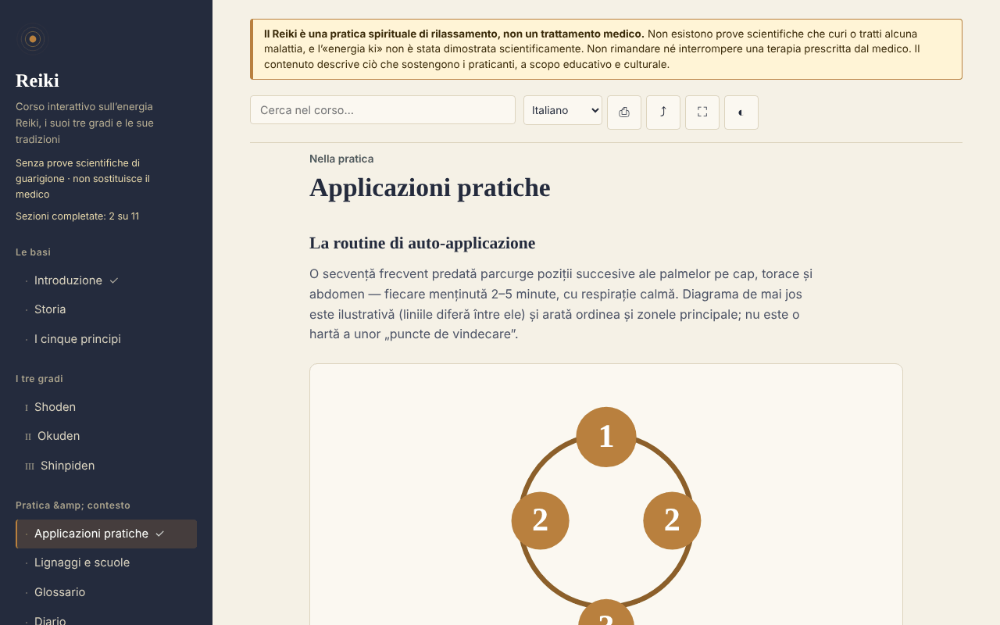

# Reiki — corso interattivo

[English](README.md) · [Română](README.ro.md) · [Français](README.fr.md) · **Italiano** · [Español](README.es.md) · [Português](README.pt.md) · [Deutsch](README.de.md) · [Magyar](README.hu.md)

**Versione:** 2.0.1 · **Ultimo aggiornamento:** 2026-10-27

**Stato:** stabile; studio descrittivo (nessuna affermazione terapeutica) · **Offline:** completo (nessuna richiesta di rete)

Lingue dell'interfaccia: **Română, English, Français, Italiano, Español, Português (PT), Deutsch, Magyar**

Corso educativo sul Reiki (storia, gradi, principi, glossario, autovalutazione), in un unico file HTML, offline. Pratica basata su credenze, senza prove scientifiche di guarigione.

**Online:** https://chiuta.github.io/Reiki/

> **Avvertenza.** Il Reiki è una pratica spirituale di rilassamento, non un trattamento medico. Non esistono prove scientifiche che guarisca o tratti alcuna malattia, e l'«energia ki» non è stata dimostrata scientificamente. Non rimandare né interrompere un trattamento prescritto dal medico. L'avvertenza è mostrata in modo permanente nella parte alta di ogni pagina dell'app.

## Che cos'è

Un'app di apprendimento in rumeno sul Reiki così come lo descrivono i praticanti: la storia (Usui, Hayashi, Takata), i tre gradi (Shoden, Okuden, Shinpiden), i cinque principi, linee e scuole, un glossario di termini giapponesi. Il contenuto descrive ciò che sostengono i praticanti, senza affermare un'efficacia medica. I punti storici che non ho potuto verificare in modo indipendente sono contrassegnati nel testo con «[neverificat]» («non verificato»).

## Funzioni

Verificate nel codice e nel browser:
- 11 sezioni (menu laterale, ☰ su dispositivi mobili): Introduzione, Storia, I cinque principi, Gradi I–III, Applicazioni pratiche (con un diagramma SVG delle posizioni), Linee e scuole, Glossario, Diario, Autovalutazione.
- Ricerca nel corso, insensibile ai segni diacritici.
- Link diretti alle sezioni (per esempio `#istoric`), e il pulsante «indietro» del browser funziona tra le sezioni.
- Stampa (solo la sezione visualizzata), condivisione (link, tramite il menu di condivisione o copiato negli appunti), schermo intero, schermo sempre acceso (dove il browser lo consente).
- Diario di pratica: testo libero, salvato automaticamente in locale (`localStorage`, chiave `reiki.jurnal`), scaricabile come `.txt`, con conferma prima di svuotarlo.
- Schede del glossario (in «Glossario», pulsante «Esercitati sui termini»): vedi il termine, mostri la definizione, segni «Lo sapevo» o «Da ripetere» (la scheda ritorna dopo 2–4 passi); i termini noti sono ricordati in locale (`reiki.glosarCunoscute`), e alla fine vieni informato di quanti ne hai spuntati. Sono nascoste in stampa.
- Autovalutazione di 10 domande con spiegazioni; l'ordine delle risposte viene mescolato a ogni tentativo.
- Progressi locali: le sezioni completate sono spuntate nel menu (con un contatore), alla fine di ogni sezione ci sono link «Precedente / Successiva», e il miglior punteggio dell'autovalutazione viene ricordato (`localStorage`, chiavi `reiki.parcurse` e `reiki.scorMax`; nulla viene inviato in rete).
- Rispetta `prefers-reduced-motion` (le animazioni SVG si fermano); funziona da 390 px di larghezza; senza JavaScript tutte le sezioni vengono mostrate una sotto l'altra.

## Guida all'uso

1. Apri la pagina e scegli una sezione dal menu a sinistra (su dispositivi mobili, premi ☰).
2. Cerca un termine nel campo di ricerca in alto; premi Invio o scegli un risultato.
3. Svolgi gli esercizi contrassegnati «Exercițiu practic» («Esercizio pratico») (sono esercizi di attenzione e rilassamento).
4. In «Jurnal» («Diario») scrivi appunti e il diario viene salvato automaticamente in questo browser; «Descarcă (.txt)» («Scarica (.txt)») ti dà una copia, e «Golește» («Svuota») lo elimina definitivamente.
5. In «Autoevaluare» («Autovalutazione») rispondi alle domande; «Reia testul» («Rifai il test») rimescola di nuovo le risposte.
6. I pulsanti della barra superiore: stampa, condivisione, schermo intero, schermo sempre acceso.

## Privacy e rete

- Archiviazione locale: il diario di pratica, in `localStorage` (chiave `reiki.jurnal`), più i progressi (`reiki.parcurse`, `reiki.scorMax`, `reiki.glosarCunoscute`), sul tuo dispositivo; nulla viene inviato altrove. Se il browser blocca l'archiviazione, il diario resta solo in memoria e il browser avvisa alla chiusura. Non si usano `sessionStorage`, IndexedDB o cookie.
- Rete: l'app non effettua alcuna richiesta di rete (non ha `fetch`, script, font, immagini o iframe esterni) e non contiene link esterni. Una politica CSP (`default-src 'none'`) nella pagina blocca qualsiasi caricamento esterno. In `<head>` compaiono solo indirizzi nei metadati Open Graph (`chiuta.github.io`), a cui l'app non accede.
- Permessi: non richiede permessi. «Schermo acceso» usa la Screen Wake Lock API, e «Condividi» usa il menu di condivisione del sistema o gli appunti, entrambi solo alla pressione del pulsante.
- Zero telemetria, nessun account.

## Limiti e avvertenze

- Non è materiale medico; non sostituisce la diagnosi, la terapia o il controllo medico. In presenza di sintomi, rivolgiti a un medico.
- Il Reiki non ha prove scientifiche di efficacia oltre al rilassamento e all'effetto placebo; le revisioni sistematiche (tra cui una Cochrane su depressione e ansia) non hanno trovato prove sufficienti. I riferimenti esatti sono ora citati nel pannello «Che cosa dicono le prove»: Joyce & Herbison, Cochrane 2015 (CD006833); Lee, Pittler & Ernst, Int J Clin Pract 2008;62(6):947–954; Jain & Mills, Int J Behav Med 2010;17(1):1–16; NCCIH. Verifica gli originali prima di citarli altrove.
- La storia segue le fonti abituali; alcuni racconti trasmessi in Occidente (in particolare quelli di Takata) sono considerati inesatti dai ricercatori. I cinque principi sono presentati nella versione occidentale, e l'app segnala che la versione giapponese differisce.
- Il diagramma delle posizioni è illustrativo, non una mappa medica.
- La pratica a distanza è descritta come una premessa dei praticanti, senza prove di effetto.

## Esecuzione locale / offline

Scarica `index.html` e aprilo in un browser; non ha bisogno di Internet. Per GitHub Pages, pubblica il repository (il file `.nojekyll` è incluso).

## Licenza

MIT — vedi il file LICENSE.

## Autore

Alexio — Alexandru-Ionuț Chiuță, contatto: alexio@trom.tf

## Riepilogo
Reiki è un corso in rumeno, in un unico file e offline, sul Reiki così come lo descrivono i praticanti: storia, tre gradi, cinque principi, linee, glossario, diario di pratica e un quiz di 10 domande. Un avviso permanente indica che il Reiki è una pratica spirituale di rilassamento, non una medicina, e che non ha prove scientifiche di guarigione. L'app non effettua richieste di rete, non usa l'archiviazione del browser e non richiede permessi; il diario può essere scaricato come file di testo. Alcuni punti storici sono esplicitamente contrassegnati come non verificati.

## Cronologia / Changelog

### 1.2.7 — 2026-10-23

- Bersagli touch di almeno 44 px sui dispositivi touch (`pointer:coarse`); il desktop resta invariato.

### 1.2.5 — 2026-10-22

fff-kit 1.1.4: target touch e dimensione minima del testo.

### 1.2.4 — 2026-10-22
- fff-kit 1.1.2: PBKDF2 con 600.000 iterazioni, protezione anti-clickjacking

### 1.2.3 — 2026-10-22
- Le finestre confirm()/prompt() del browser sostituite da finestre di dialogo proprie, tradotte nelle 8 lingue (svuotamento del diario, copia manuale del link).

### 1.1.0 — 2026-10-14
- Copia di riserva ed etichettatura dei dati (fff-kit).

### 12 ottobre 2026 (v1.0.0)
- 1.0.0 — 2026-10-12: la versione e la data dell'ultimo aggiornamento sono mostrate nell'app

### 11 ottobre 2026
- Schede del glossario («Esercitati sui termini», progressi locali in `reiki.glosarCunoscute`); testato: percorso completo, persistenza dopo il ricaricamento, axe 0 in entrambe le dimensioni.
- Progressi di apprendimento locali (sezioni completate + contatore), navigazione Precedente/Successiva tra le sezioni, miglior punteggio al test; CSP con `script-src` tramite hash SHA-256, senza `'unsafe-inline'` per gli script.
- Il diario di pratica viene ora salvato in locale (`localStorage`) e resta dopo il ricaricamento; «Golește» («Svuota») lo elimina.
- I risultati della ricerca sono un elenco (`ul`) con il numero di sezioni trovate.
- Aggiunto un `h1` accessibile nel contenuto (axe `page-has-heading-one` su dispositivi mobili); axe 0 violazioni a 1280 e 360 px.

Fonti verificate l'11.10.2026: non sono stati citati nuovi fatti esterni; i punti storici non verificati restano contrassegnati «[neverificat]»
