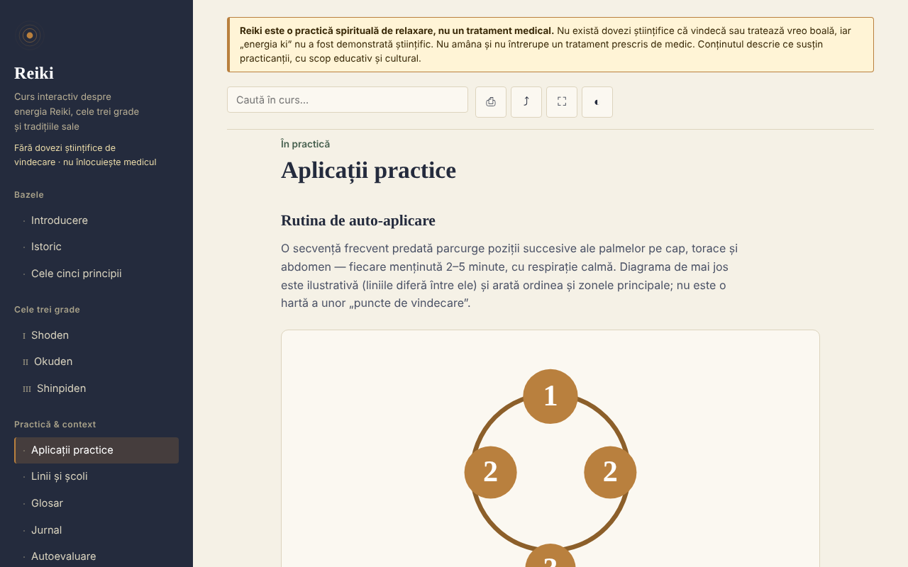

# Reiki — curs interactiv

**Versiune:** 1.1.0 · **Ultima actualizare:** 14 octombrie 2026

Curs educativ despre Reiki (istoric, grade, principii, glosar, autoevaluare), într-un singur fișier HTML, offline. Practică bazată pe credințe, fără dovezi științifice de vindecare.

**Live:** https://chiuta.github.io/Reiki/

> **Avertisment.** Reiki este o practică spirituală de relaxare, nu un tratament medical. Nu există dovezi științifice că vindecă sau tratează vreo boală, iar „energia ki" nu a fost demonstrată științific. Nu amâna și nu întrerupe un tratament prescris de medic. Avertismentul este afișat permanent în partea de sus a fiecărei pagini a aplicației.

## Ce este

O aplicație de învățare în română despre Reiki așa cum îl descriu practicanții: istoricul (Usui, Hayashi, Takata), cele trei grade (Shoden, Okuden, Shinpiden), cele cinci principii, linii și școli, glosar de termeni japonezi. Conținutul descrie ce susțin practicanții, nu afirmă eficacitate medicală. Punctele istorice pe care nu le-am putut verifica independent sunt marcate „[neverificat]" în text.

## Funcții

Verificate în cod și în browser:
- 11 secțiuni (meniu lateral, ☰ pe mobil): Introducere, Istoric, Cele cinci principii, Gradele I–III, Aplicații practice (cu diagramă SVG a pozițiilor), Linii și școli, Glosar, Jurnal, Autoevaluare.
- Căutare în curs, fără sensibilitate la diacritice.
- Linkuri directe către secțiuni (de exemplu `#istoric`), butonul „înapoi" al browserului funcționează între secțiuni.
- Tipărire (doar secțiunea afișată), distribuire (link, prin meniul de partajare sau copiat în clipboard), ecran complet, menținerea ecranului activ (acolo unde browserul o permite).
- Jurnal de practică: text liber, salvat automat local (`localStorage`, cheia `reiki.jurnal`), descărcabil ca `.txt`, cu confirmare la golire.
- Cartonașe pentru glosar (în „Glosar”, butonul „Exersează termenii”): vezi termenul, arăți definiția, marchezi „Știam” sau „Mai repet” (cartonașul revine după 2–4 pași); termenii știuți se rețin local (`reiki.glosarCunoscute`), iar la final ești anunțat câți ai bifat. Se ascund la tipărire.
- Autoevaluare de 10 întrebări cu explicații; ordinea răspunsurilor se amestecă la fiecare încercare.
- Progres local: secțiunile parcurse sunt bifate în meniu (cu contor), la finalul fiecărei secțiuni sunt linkuri „Anterior / Următor”, iar cel mai bun scor la autoevaluare e reținut (`localStorage`, cheile `reiki.parcurse` și `reiki.scorMax`; fără trimitere în rețea).
- Respectă `prefers-reduced-motion` (animațiile SVG se opresc); funcționează de la 390 px lățime; fără JavaScript se afișează toate secțiunile unele sub altele.

## Manual de utilizare

1. Deschide pagina și alege o secțiune din meniul din stânga (pe mobil, apasă ☰).
2. Caută un termen în câmpul de căutare din partea de sus; apasă Enter sau alege un rezultat.
3. Parcurge exercițiile marcate „Exercițiu practic" (sunt exerciții de atenție și relaxare).
4. În „Jurnal" scrie notițe și jurnalul se salvează automat în acest browser; „Descarcă (.txt)" îți dă o copie, iar „Golește" îl șterge definitiv.
5. În „Autoevaluare" răspunde la întrebări; „Reia testul" amestecă din nou răspunsurile.
6. Butoanele din bara de sus: tipărire, distribuire, ecran complet, ecran activ.

## Confidențialitate și rețea

- Stocare locală: jurnalul de practică, în `localStorage` (cheia `reiki.jurnal`), plus progresul (`reiki.parcurse`, `reiki.scorMax`, `reiki.glosarCunoscute`), pe dispozitivul tău; nu se trimite nicăieri. Dacă browserul blochează stocarea, jurnalul rămâne doar în memorie și browserul avertizează la închidere. Nu se folosesc `sessionStorage`, IndexedDB sau cookie-uri.
- Rețea: aplicația nu face nicio cerere de rețea (nu are `fetch`, scripturi, fonturi, imagini sau iframe-uri externe) și nu conține linkuri externe. O politică CSP (`default-src 'none'`) din pagină blochează orice încărcare externă. În `<head>` apar doar adrese în metadatele Open Graph (`chiuta.github.io`), care nu sunt accesate de aplicație.
- Permisiuni: nu cere permisiuni. „Ecran activ" folosește Screen Wake Lock API, iar „Distribuie" folosește meniul de partajare al sistemului sau clipboard-ul, ambele doar la apăsarea butonului.
- Zero telemetrie, fără conturi.

## Limite și avertismente

- Nu este material medical; nu înlocuiește diagnosticul, tratamentul sau supravegherea medicală. Pentru simptome, mergi la medic.
- Reiki nu are dovezi științifice de eficacitate dincolo de relaxare și efect placebo; recenziile sistematice (inclusiv una Cochrane despre depresie și anxietate) nu au găsit dovezi suficiente. Referința exactă nu este citată în aplicație, deci verific-o înainte de a o cita mai departe.
- Istoricul urmează sursele uzuale; unele relatări transmise în Occident (în special cele ale lui Takata) sunt considerate inexacte de cercetători. Cele cinci principii sunt prezentate în varianta occidentală, iar aplicația notează că versiunea japoneză diferă.
- Diagrama pozițiilor este ilustrativă, nu o hartă medicală.
- Practica la distanță este descrisă ca premisă a practicanților, fără dovezi de efect.

## Rulare locală / offline

Descarcă `index.html` și deschide-l în browser; nu are nevoie de internet. Pentru GitHub Pages, publică repository-ul (fișierul `.nojekyll` este inclus).

## Licență

MIT — vezi fișierul LICENSE.

## Autor

Alexio — Alexandru-Ionuț Chiuță, contact: alexio@trom.tf

## English summary

Reiki is a single-file, offline, Romanian-language course on Reiki as practitioners describe it: history, three degrees, five precepts, lineages, glossary, practice journal and a 10-question quiz. A permanent notice states that Reiki is a spiritual relaxation practice, not medicine, and has no scientific evidence of healing. The app makes no network requests, uses no browser storage and requests no permissions; the journal can be downloaded as a text file. Some historical points are explicitly marked as unverified.

## Istoric / Changelog

### 1.1.0 — 2026-10-14
- Copie de rezervă și etichetare date (fff-kit).

### 12 octombrie 2026 (v1.0.0)
- 1.0.0 — 2026-10-12: versiunea și data ultimei actualizări sunt afișate în aplicație

### 11 octombrie 2026
- Cartonașe pentru glosar („Exersează termenii”, progres local în `reiki.glosarCunoscute`); testat: parcurgere completă, persistență după reîncărcare, axe 0 în ambele dimensiuni.
- Progres de învățare local (secțiuni parcurse + contor), navigare Anterior/Următor între secțiuni, cel mai bun scor la test; CSP cu `script-src` pe hash SHA-256, fără `'unsafe-inline'` pentru scripturi.
- Jurnalul de practică se salvează acum local (`localStorage`) și rămâne după reîncărcare; „Golește" îl șterge.
- Rezultatele căutării sunt o listă (`ul`) cu numărul de secțiuni găsite.
- Adăugat `h1` accesibil în conținut (axe `page-has-heading-one` pe mobil); axe 0 violări la 1280 și 360 px.

Surse verificate la 11.10.2026: nu s-au citat fapte externe noi; punctele istorice neverificate rămân marcate „[neverificat]"
