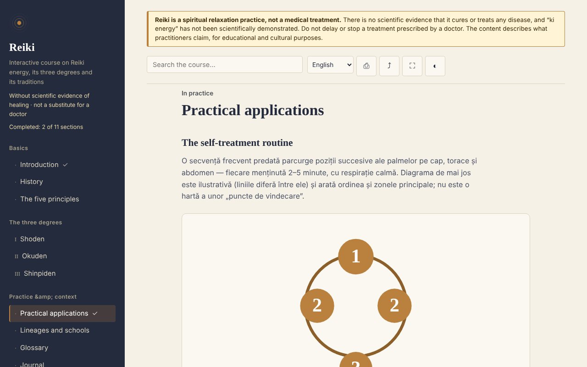

# Reiki — interactive course

**English** · [Română](README.ro.md) · [Français](README.fr.md) · [Italiano](README.it.md) · [Español](README.es.md) · [Português](README.pt.md) · [Deutsch](README.de.md) · [Magyar](README.hu.md)

**Version:** 2.0.2 · **Last updated:** 2026-10-27

**Status:** stable; descriptive study (no therapeutic claims) · **Offline:** complete (no network requests)

Interface languages: **Română, English, Français, Italiano, Español, Português (PT), Deutsch, Magyar**

An educational course on Reiki (history, degrees, principles, glossary, self-assessment), in a single, offline HTML file. A belief-based practice, with no scientific evidence of healing.

**Live:** https://chiuta.github.io/Reiki/

> **Warning.** Reiki is a spiritual relaxation practice, not a medical treatment. There is no scientific evidence that it cures or treats any illness, and "ki energy" has not been scientifically demonstrated. Do not delay or stop a treatment prescribed by a doctor. The warning is displayed permanently at the top of every page of the app.

## What it is

A learning app in Romanian about Reiki as practitioners describe it: its history (Usui, Hayashi, Takata), the three degrees (Shoden, Okuden, Shinpiden), the five precepts, lineages and schools, a glossary of Japanese terms. The content describes what practitioners claim; it does not assert medical efficacy. Historical points that I could not verify independently are marked "[neverificat]" ("unverified") in the text.

## Features

Checked in code and in the browser:
- 11 sections (side menu, ☰ on mobile): Introduction, History, The five precepts, Degrees I–III, Practical applications (with an SVG diagram of the positions), Lineages and schools, Glossary, Journal, Self-assessment.
- Search within the course, insensitive to diacritics.
- Direct links to sections (for example `#istoric`), and the browser's "back" button works between sections.
- Printing (only the displayed section), sharing (link, through the share menu or copied to the clipboard), full screen, keeping the screen awake (where the browser allows it).
- Practice journal: free text, saved automatically in the browser (`localStorage`, key `reiki.jurnal`), downloadable as `.txt`, with confirmation before clearing.
- Glossary flashcards (in "Glossary", the "Practise the terms" button): you see the term, reveal the definition, mark "I knew it" or "Repeat more" (the card comes back after 2–4 steps); known terms are remembered locally (`reiki.glosarCunoscute`), and at the end you are told how many you ticked. They are hidden when printing.
- A 10-question self-assessment with explanations; the order of the answers is shuffled at every attempt.
- Local progress: completed sections are ticked in the menu (with a counter), at the end of each section there are "Previous / Next" links, and the best self-assessment score is remembered (`localStorage`, keys `reiki.parcurse` and `reiki.scorMax`; nothing is sent over the network).
- Respects `prefers-reduced-motion` (SVG animations stop); works from 390 px width; without JavaScript all sections are displayed one under another.

## User guide

1. Open the page and choose a section from the menu on the left (on mobile, press ☰).
2. Search for a term in the search field at the top; press Enter or pick a result.
3. Go through the exercises marked "Exercițiu practic" ("Practical exercise") (they are attention and relaxation exercises).
4. In "Jurnal" ("Journal") write notes and the journal is saved automatically in this browser; "Descarcă (.txt)" ("Download (.txt)") gives you a copy, and "Golește" ("Clear") deletes it permanently.
5. In "Autoevaluare" ("Self-assessment") answer the questions; "Reia testul" ("Retake the test") shuffles the answers again.
6. The buttons in the top bar: print, share, full screen, keep screen on.

## Privacy and network

- Local storage: the practice journal, in `localStorage` (key `reiki.jurnal`), plus progress (`reiki.parcurse`, `reiki.scorMax`, `reiki.glosarCunoscute`), on your device; nothing is sent anywhere. If the browser blocks storage, the journal stays only in memory and the browser warns on closing. `sessionStorage`, IndexedDB and cookies are not used.
- Network: the app makes no network request (it has no `fetch`, external scripts, fonts, images or iframes) and contains no external links. A CSP policy (`default-src 'none'`) in the page blocks any external loading. In `<head>` there are only addresses in the Open Graph metadata (`chiuta.github.io`), which the app does not access.
- Permissions: it requests no permissions. "Keep screen on" uses the Screen Wake Lock API, and "Share" uses the system share menu or the clipboard, both only when you press the button.
- Zero telemetry, no accounts.

## Limits and warnings

- It is not medical material; it does not replace medical diagnosis, treatment or supervision. For symptoms, see a doctor.
- Reiki has no scientific evidence of efficacy beyond relaxation and the placebo effect. The "What the evidence says" panel now cites: Joyce & Herbison, Cochrane 2015 (CD006833); Lee, Pittler & Ernst, Int J Clin Pract 2008;62(6):947-954; Jain & Mills, Int J Behav Med 2010;17(1):1-16; NCCIH. Check the originals before citing further.
- The history follows the usual sources; some accounts handed down in the West (especially Takata's) are considered inaccurate by researchers. The five precepts are presented in the Western version, and the app notes that the Japanese version differs.
- The diagram of positions is illustrative, not a medical map.
- Distance practice is described as a premise of practitioners, with no evidence of effect.

## Running locally / offline

Download `index.html` and open it in a browser; it needs no internet. For GitHub Pages, publish the repository (the `.nojekyll` file is included).

## Evidence panel: exact sources (2026-10-27)

The "What the evidence says" panel now lists its sources in all 8 languages: Joyce & Herbison, *Cochrane Database Syst Rev* 2015;(4):CD006833; Lee, Pittler & Ernst, *Int J Clin Pract* 2008;62(6):947-954; Jain & Mills, *Int J Behav Med* 2010;17(1):1-16; NCCIH (NIH) "Reiki". The wording stays cautious: insufficient evidence, no therapeutic claim.

### Source check (2026-10-27, 2.0.2)

- **Confirmed on publisher/registry pages**: Joyce & Herbison, *Cochrane Database Syst Rev* 2015, Issue 4, CD006833, DOI 10.1002/14651858.CD006833.pub2 (published 3 April 2015; Cochrane: "insufficient evidence to say whether or not Reiki is useful"); Lee, Pittler & Ernst 2008, title, PMID 18410352 and DOI 10.1111/j.1742-1241.2008.01729.x (abstract: "the evidence is insufficient to suggest that reiki is an effective treatment for any condition"); Jain & Mills 2010, title and DOI 10.1007/s12529-009-9062-4; NCCIH "Reiki" page (nccih.nih.gov/health/reiki, page dated December 2018: "hasn't been clearly shown to be effective for any health-related purpose").
- **Not confirmed**: the volume/issue/pages `62(6):947-954` (Lee et al.) and `17(1):1-16` (Jain & Mills) were not visible on the pages I could open; they stay as in 2.0.1 and the DOIs were added so they can be checked.
- The Cochrane review dates from 2015 (search to November 2014); a newer version was not looked for here.

## License

MIT — see the LICENSE file.

## Author

Alexio — Alexandru-Ionuț Chiuță, contact: alexio@trom.tf

## English summary

Reiki is a single-file, offline, Romanian-language course on Reiki as practitioners describe it: history, three degrees, five precepts, lineages, glossary, practice journal and a 10-question quiz. A permanent notice states that Reiki is a spiritual relaxation practice, not medicine, and has no scientific evidence of healing. The app makes no network requests, uses no browser storage and requests no permissions; the journal can be downloaded as a text file. Some historical points are explicitly marked as unverified.

## History / Changelog

### 1.2.7 — 2026-10-23

- Touch targets of at least 44 px on touch devices (`pointer:coarse`); desktop is unchanged.

### 1.2.5 — 2026-10-22

fff-kit 1.1.4: touch targets and minimum text size.

### 1.2.4 — 2026-10-22
- fff-kit 1.1.2: PBKDF2 600,000 iterations, anti-clickjacking protection

### 1.2.3 — 2026-10-22
- Native browser confirm()/prompt() boxes replaced by own dialogs translated into the 8 languages (clearing the journal, manual link copy).

### 1.1.0 — 2026-10-14
- Backup and data labelling (fff-kit).

### 12 October 2026 (v1.0.0)
- 1.0.0 — 2026-10-12: the version and the date of the last update are shown in the app

### 11 October 2026
- Glossary flashcards ("Practise the terms", local progress in `reiki.glosarCunoscute`); tested: full run-through, persistence after reload, axe 0 at both sizes.
- Local learning progress (completed sections + counter), Previous/Next navigation between sections, best quiz score; CSP with `script-src` by SHA-256 hash, without `'unsafe-inline'` for scripts.
- The practice journal is now saved locally (`localStorage`) and remains after reload; "Golește" ("Clear") deletes it.
- Search results are a list (`ul`) with the number of sections found.
- Added an accessible `h1` in the content (axe `page-has-heading-one` on mobile); axe 0 violations at 1280 and 360 px.

Sources checked on 11.10.2026: no new external facts were cited; unverified historical points remain marked "[neverificat]"
