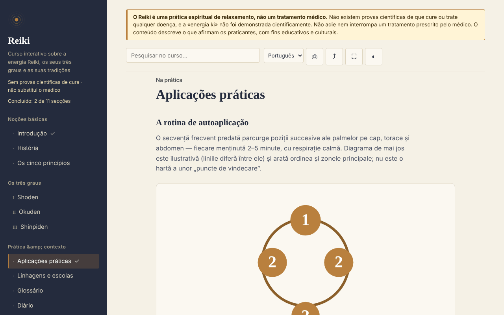

# Reiki — curso interativo

[English](README.md) · [Română](README.ro.md) · [Français](README.fr.md) · [Italiano](README.it.md) · [Español](README.es.md) · **Português** · [Deutsch](README.de.md) · [Magyar](README.hu.md)

**Versão:** 2.0.2 · **Última atualização:** 2026-10-27

**Estado:** estável; estudo descritivo (sem alegações terapêuticas) · **Offline:** completo (sem pedidos de rede)

Idiomas da interface: **Română, English, Français, Italiano, Español, Português (PT), Deutsch, Magyar**

Curso educativo sobre Reiki (história, graus, princípios, glossário, autoavaliação), num único ficheiro HTML, offline. Prática baseada em crenças, sem provas científicas de cura.

**Online:** https://chiuta.github.io/Reiki/

> **Aviso.** O Reiki é uma prática espiritual de relaxamento, não um tratamento médico. Não existem provas científicas de que cure ou trate qualquer doença, e a «energia ki» não foi demonstrada cientificamente. Não adie nem interrompa um tratamento prescrito por um médico. O aviso é apresentado de forma permanente no topo de cada página da aplicação.

## O que é

Uma aplicação de aprendizagem em romeno sobre o Reiki tal como o descrevem os praticantes: a história (Usui, Hayashi, Takata), os três graus (Shoden, Okuden, Shinpiden), os cinco princípios, linhagens e escolas, um glossário de termos japoneses. O conteúdo descreve o que defendem os praticantes, sem afirmar eficácia médica. Os pontos históricos que não consegui verificar de forma independente estão assinalados no texto como «[neverificat]» («não verificado»).

## Funcionalidades

Verificadas no código e no navegador:
- 11 secções (menu lateral, ☰ no telemóvel): Introdução, História, Os cinco princípios, Graus I–III, Aplicações práticas (com um diagrama SVG das posições), Linhagens e escolas, Glossário, Diário, Autoavaliação.
- Pesquisa no curso, insensível aos sinais diacríticos.
- Ligações diretas às secções (por exemplo `#istoric`), e o botão «voltar» do navegador funciona entre secções.
- Impressão (apenas a secção apresentada), partilha (ligação, através do menu de partilha ou copiada para a área de transferência), ecrã inteiro, manter o ecrã ativo (onde o navegador o permita).
- Diário de prática: texto livre, guardado automaticamente em local (`localStorage`, chave `reiki.jurnal`), transferível como `.txt`, com confirmação antes de esvaziar.
- Cartões do glossário (em «Glossário», botão «Pratica os termos»): vê o termo, revela a definição, marca «Sabia» ou «Repetir mais» (o cartão volta após 2–4 passos); os termos conhecidos ficam guardados localmente (`reiki.glosarCunoscute`), e no final é informado de quantos assinalou. Ficam ocultos na impressão.
- Autoavaliação de 10 perguntas com explicações; a ordem das respostas é baralhada a cada tentativa.
- Progresso local: as secções percorridas são assinaladas no menu (com um contador), no fim de cada secção há ligações «Anterior / Seguinte», e a melhor pontuação da autoavaliação fica guardada (`localStorage`, chaves `reiki.parcurse` e `reiki.scorMax`; nada é enviado pela rede).
- Respeita `prefers-reduced-motion` (as animações SVG param); funciona a partir de 390 px de largura; sem JavaScript, todas as secções são apresentadas umas sob as outras.

## Manual de utilização

1. Abra a página e escolha uma secção no menu da esquerda (no telemóvel, prima ☰).
2. Procure um termo no campo de pesquisa no topo; prima Enter ou escolha um resultado.
3. Faça os exercícios assinalados «Exercițiu practic» («Exercício prático») (são exercícios de atenção e relaxamento).
4. Em «Jurnal» («Diário») escreva notas e o diário é guardado automaticamente neste navegador; «Descarcă (.txt)» («Transferir (.txt)») dá-lhe uma cópia, e «Golește» («Esvaziar») apaga-o definitivamente.
5. Em «Autoevaluare» («Autoavaliação») responda às perguntas; «Reia testul» («Repetir o teste») volta a baralhar as respostas.
6. Os botões da barra superior: imprimir, partilhar, ecrã inteiro, ecrã ativo.

## Privacidade e rede

- Armazenamento local: o diário de prática, em `localStorage` (chave `reiki.jurnal`), mais o progresso (`reiki.parcurse`, `reiki.scorMax`, `reiki.glosarCunoscute`), no seu dispositivo; não é enviado para lado nenhum. Se o navegador bloquear o armazenamento, o diário fica apenas em memória e o navegador avisa ao fechar. Não se usam `sessionStorage`, IndexedDB nem cookies.
- Rede: a aplicação não faz qualquer pedido de rede (não tem `fetch`, scripts, tipos de letra, imagens ou iframes externos) e não contém ligações externas. Uma política CSP (`default-src 'none'`) na página bloqueia qualquer carregamento externo. Em `<head>` aparecem apenas endereços nos metadados Open Graph (`chiuta.github.io`), a que a aplicação não acede.
- Permissões: não solicita permissões. «Ecrã ativo» usa a Screen Wake Lock API, e «Partilhar» usa o menu de partilha do sistema ou a área de transferência, ambos apenas quando prime o botão.
- Zero telemetria, sem contas.

## Limites e avisos

- Não é material médico; não substitui o diagnóstico, o tratamento ou o acompanhamento médico. Perante sintomas, consulte um médico.
- O Reiki não tem provas científicas de eficácia para além do relaxamento e do efeito placebo; as revisões sistemáticas (incluindo uma da Cochrane sobre depressão e ansiedade) não encontraram provas suficientes. As referências exatas são agora citadas no painel «O que dizem as provas»: Joyce & Herbison, Cochrane 2015 (CD006833); Lee, Pittler & Ernst, Int J Clin Pract 2008;62(6):947–954; Jain & Mills, Int J Behav Med 2010;17(1):1–16; NCCIH. Verifique os originais antes de as citar noutro lugar.
- A história segue as fontes habituais; alguns relatos transmitidos no Ocidente (em especial os de Takata) são considerados inexatos pelos investigadores. Os cinco princípios são apresentados na versão ocidental, e a aplicação assinala que a versão japonesa difere.
- O diagrama das posições é ilustrativo, não um mapa médico.
- A prática à distância é descrita como uma premissa dos praticantes, sem provas de efeito.

## Execução local / offline

Transfira `index.html` e abra-o num navegador; não precisa de Internet. Para o GitHub Pages, publique o repositório (o ficheiro `.nojekyll` está incluído).

## Licença

MIT — veja o ficheiro LICENSE.

## Autor

Alexio — Alexandru-Ionuț Chiuță, contacto: alexio@trom.tf

## Resumo
Reiki é um curso em romeno, num único ficheiro e offline, sobre o Reiki tal como o descrevem os praticantes: história, três graus, cinco princípios, linhagens, glossário, diário de prática e um questionário de 10 perguntas. Um aviso permanente indica que o Reiki é uma prática espiritual de relaxamento, não medicina, e que não tem provas científicas de cura. A aplicação não faz pedidos de rede, não usa o armazenamento do navegador e não solicita permissões; o diário pode ser transferido como ficheiro de texto. Alguns pontos históricos estão explicitamente assinalados como não verificados.

## Histórico / Changelog

### 1.2.7 — 2026-10-23

- Alvos de toque de pelo menos 44 px em dispositivos táteis (`pointer:coarse`); o computador não muda.

### 1.2.5 — 2026-10-22

fff-kit 1.1.4: alvos de toque e tamanho mínimo do texto.

### 1.2.4 — 2026-10-22
- fff-kit 1.1.2: PBKDF2 com 600.000 iterações, proteção anti-clickjacking

### 1.2.3 — 2026-10-22
- As caixas confirm()/prompt() do navegador substituídas por diálogos próprios traduzidos nos 8 idiomas (limpar o diário, cópia manual da ligação).

### 1.1.0 — 2026-10-14
- Cópia de segurança e etiquetagem de dados (fff-kit).

### 12 de outubro de 2026 (v1.0.0)
- 1.0.0 — 2026-10-12: a versão e a data da última atualização são apresentadas na aplicação

### 11 de outubro de 2026
- Cartões do glossário («Pratica os termos», progresso local em `reiki.glosarCunoscute`); testado: percurso completo, persistência após recarregar, axe 0 em ambos os tamanhos.
- Progresso de aprendizagem local (secções percorridas + contador), navegação Anterior/Seguinte entre secções, melhor pontuação no teste; CSP com `script-src` por hash SHA-256, sem `'unsafe-inline'` para scripts.
- O diário de prática é agora guardado localmente (`localStorage`) e permanece após recarregar; «Golește» («Esvaziar») apaga-o.
- Os resultados da pesquisa são uma lista (`ul`) com o número de secções encontradas.
- Adicionado um `h1` acessível no conteúdo (axe `page-has-heading-one` no telemóvel); axe 0 violações a 1280 e 360 px.

Fontes verificadas a 11.10.2026: não foram citados factos externos novos; os pontos históricos não verificados continuam assinalados como «[neverificat]»
